<!-- ██████╗ ██╗   ██╗██████╗ ███████╗██████╗ ██████╗ ██╗   ██╗███╗   ██╗██╗  ██╗ -->
<!-- ██╔══██╗╚██╗ ██╔╝██╔══██╗██╔════╝██╔══██╗██╔═══██╗██║   ██║████╗  ██║██║ ██╔╝ -->
<!-- ██████╔╝ ╚████╔╝ ██████╔╝█████╗  ██████╔╝██║   ██║██║   ██║██╔██╗ ██║█████╔╝  -->
<!-- ██╔═══╝   ╚██╔╝  ██╔═══╝ ██╔══╝  ██╔══██╗██║   ██║██║   ██║██║╚██╗██║██╔═██╗  -->
<!-- ██║        ██║   ██║     ███████╗██║  ██║╚██████╔╝╚██████╔╝██║ ╚████║██║  ██╗ -->
<!-- ╚═╝        ╚═╝   ╚═╝     ╚══════╝╚═╝  ╚═╝ ╚═════╝  ╚═════╝ ╚═╝  ╚═══╝╚═╝  ╚═╝ -->

<div align="center">

<picture>
  <source media="(prefers-color-scheme: dark)" srcset="./assets/hero-dark.svg" />
  <source media="(prefers-color-scheme: light)" srcset="./assets/hero-light.svg" />
  
</picture>


<a href="https://github.com/oneincase"></a>




<a href="#-关于我--about-me"></a> <a href="#-旗舰项目--flagship-projects"></a> <a href="#-更多项目--more-projects"></a> <a href="#-技术栈--tech-stack"></a> <a href="#-数据流--telemetry"></a> <a href="#-贪吃蛇--snake"></a>

</div>


## 🙋‍♂️ 关于我 / About Me

```text
[ oneincase@neon ~ ]$ whoami

  身份 / IDENTITY  |  独立开发者 · 桌面引擎工程师 / indie dev · desktop-engineer
  坐标 / NODE      |  赛博空间 · CYBERSPACE
  主力 / WEAPON    |  Rust 🦀  ·  GPU 优先 / GPU-first
  副手 / SIDEARM   |  WebGL 🎨 · Tauri ⚙️ · React ⚛️ · Vue 💚
  燃料 / FUEL      |  鱼 🐟  ·  冷却 / COOLANT: 咖啡 ☕
  状态 / STATUS    |  ● ONLINE —— 正在编译中 / compiling…

[ oneincase@neon ~ ]$ _
```

- 🔭 正在打造 **[WallpaperEM](https://github.com/oneincase/WallpaperEM)** —— 极致优雅的全平台桌面壁纸引擎
- 🔭 Building **[WallpaperEM](https://github.com/oneincase/WallpaperEM)** — a supremely elegant, cross-platform wallpaper engine
- 🤝 深度参与 **[dsh-wallpaper-engine](https://github.com/elysia395/dsh-wallpaper-engine)** —— 其内置 WebWallGL 渲染引擎与 media-bridge 中间件的作者
- 🤝 Core contributor to **[dsh-wallpaper-engine](https://github.com/elysia395/dsh-wallpaper-engine)** — author of its built-in WebWallGL renderer and media-bridge middleware
- 🦀 主力 Rust 🦀，常伴 WebGL 🎨 / Tauri ⚙️ / React ⚛️ / Vue 💚
- 🦀 Rust by day, with WebGL 🎨 / Tauri ⚙️ / React ⚛️ / Vue 💚 by night
- 🎨 相信桌面不只是背景，更是表达自我的画布
- 🎨 A desktop is not just a background — it's a canvas for self-expression
- ⚡ 性能强迫症：能用 GPU 解决的事，绝不麻烦 CPU
- ⚡ Performance obsessive: if the GPU can do it, never bother the CPU
- 🐟 爱吃鱼，也爱写代码 —— 两者都很「鲜」
- 🐟 Love eating fish and shipping code — both are super fresh


## 🌟 旗舰项目 / Flagship Projects

<!-- ─────────────── 01 · dsh-wallpaper-engine ─────────────── -->

### 🖥️ [dsh-wallpaper-engine](https://github.com/elysia395/dsh-wallpaper-engine) · 🤝 核心贡献者 / Core Contributor

<a href="https://github.com/elysia395/dsh-wallpaper-engine/stargazers"></a>


> **把你电脑上的 Wallpaper Engine 壁纸搬进 DSH 网页界面 —— 实时 WebGL 渲染 + iOS 液态玻璃。**
> **Bring your local Wallpaper Engine wallpapers into the DSH web UI — real-time WebGL rendering with an iOS liquid-glass look.**

```text
┌─[ dsh-wallpaper-engine ]─────────────────────────────────────────────────────┐
│ IN  ▸ 本地 Wallpaper Engine 壁纸库 / local WE wallpaper library              │
│ OUT ▸ DSH 网页界面内实时渲染 / live render inside the DSH web UI             │
│ HOT ▸ WebGL · 液态玻璃 · 三平台原生媒体链路 / WebGL · liquid glass · media   │
└──────────────────────────────────────────────────────────────────────────────┘
```

- 🎬 **三类壁纸、三条渲染路径** · 场景实时 WebGL 渲染（粒子 / puppet 骨骼 / SceneScript / 音频反应 / 鼠标视差）、网页严格沙箱 + 注入 WE API、视频直接播放 · Scene / Web / Video, three render paths
- 🪜 **实时优先、逐级降级** · 渲染失败沿降级链自动回退（内嵌 MP4 → 实时抓帧 → 空态），首帧之前不留黑屏 · Real-time first, graceful fallback, never a black frame
- 🍎 **iOS 液态玻璃界面** · 配色 / 玻璃 / 字体 / 侧栏全可细调，跟随 DSH 界面语言即时切换 · Liquid-glass UI, fully tunable, follows the DSH locale
- 🔋 **省电与降载** · 遮挡暂停（最小化 / 失焦 / 电池）直接停解码；ffmpeg 帧率上限一次性转码（4K 保留 + AV1）· Occlusion pause + one-shot frame-rate cap
- 🧩 **能搬的都搬** · 自定义上传 / 自动轮播 / 系统音频频谱与 Now Playing；设置存宿主端，对 agent 零 token 开销 · Uploads, rotation, audio spectrum, host-side settings
- ❤️ **我与它的关系** · 它内置的实时渲染引擎 [**webwallgl**](https://github.com/oneincase/webwallgl) 与媒体中间件 [**media-bridge**](https://github.com/oneincase/media-bridge) 由我编写 —— 场景 / 网页壁纸的实时渲染与三平台原生媒体链路都建立在它们之上

<!-- ─────────────── 02 · WallpaperEM ─────────────── -->

### 🖼️ [WallpaperEM](https://github.com/oneincase/WallpaperEM)

<a href="https://github.com/oneincase/WallpaperEM/stargazers"></a>


> **极致优雅的全平台桌面壁纸引擎，绝非 WE 的简单复刻！**
> **A supremely elegant cross-platform wallpaper engine — far more than a WE clone!**

- 🌈 支持 **场景 / 网页 / 视频 / 图片** 四类壁纸 · Supports **scene / web / video / image** wallpapers
- 📦 极小安装包 · 依赖解耦 · 按需加载 · Tiny installer with decoupled, on-demand dependencies
- 🚀 极致性能 · 多档画质预设 · Blazing performance with quality presets
- 🤖 AI 壁纸创作，一句话生成画面 · AI wallpaper authoring from a single prompt
- 📱 手机扫码分享，链接实时渲染 · Share to your phone — the link renders wallpapers live

<!-- ─────────────── 03 · webwallgl ─────────────── -->

### 🌐 [webwallgl](https://github.com/oneincase/webwallgl)

<a href="https://github.com/oneincase/webwallgl/stargazers"></a>


> **浏览器版 Wallpaper Engine 场景渲染器** —— npm / CDN 开箱即用（MIT）
> **Wallpaper Engine scene renderer for the browser** — npm / CDN ready out of the box (MIT)


## 🧰 更多项目 / More Projects

| 📦 项目 / Project | ✨ 简介 / Intro |
| --- | --- |
| 🎵 [**media-bridge**](https://github.com/oneincase/media-bridge) | 跨平台「正在播放 + 系统音频频谱 + 媒体控制」中间件，零外部依赖 / Cross-platform Now Playing, audio spectrum & media-control middleware, zero external deps |
| 🔍 [**utools-polymerization-ocr**](https://github.com/oneincase/utools-polymerization-ocr) | uTools 聚合文字识别插件 / Aggregated OCR plugin for uTools |
| 🍩 [**DonutLauncher**](https://github.com/oneincase/DonutLauncher) | 圆形甜甜圈启动器 / A circular donut-shaped launcher |


## 🛠️ 技术栈 / Tech Stack

<div align="center">


<br/>


<br/>


</div>


## 📊 数据流 / Telemetry

<div align="center">

<picture>
  <source media="(prefers-color-scheme: dark)" srcset="https://github-profile-summary-cards.vercel.app/api/cards/profile-details?username=oneincase&theme=2077" />
  <source media="(prefers-color-scheme: light)" srcset="https://github-profile-summary-cards.vercel.app/api/cards/profile-details?username=oneincase&theme=default" />
  
</picture>

<picture>
  <source media="(prefers-color-scheme: dark)" srcset="https://github-readme-stats.vercel.app/api?username=oneincase&show_icons=true&hide_border=true&bg_color=0D0221&title_color=00E5FF&icon_color=FF2E97&text_color=C8D6F5&count_private=true" />
  <source media="(prefers-color-scheme: light)" srcset="https://github-readme-stats.vercel.app/api?username=oneincase&show_icons=true&hide_border=true&title_color=007C91&icon_color=E0117A&text_color=3A2E4F&count_private=true" />
  
</picture>
<picture>
  <source media="(prefers-color-scheme: dark)" srcset="https://github-readme-stats.vercel.app/api/top-langs/?username=oneincase&layout=compact&hide_border=true&bg_color=0D0221&title_color=00E5FF&text_color=C8D6F5" />
  <source media="(prefers-color-scheme: light)" srcset="https://github-readme-stats.vercel.app/api/top-langs/?username=oneincase&layout=compact&hide_border=true&title_color=007C91&text_color=3A2E4F" />
  
</picture>

<picture>
  <source media="(prefers-color-scheme: dark)" srcset="https://streak-stats.demolab.com?user=oneincase&hide_border=true&background=0D0221&border=2C1150&stroke=2C1150&ring=00E5FF&fire=FF2E97&currStreakNum=EAF6FF&currStreakLabel=00E5FF&sideNums=C8D6F5&sideLabels=9AA5CE&dates=6B7BA8" />
  <source media="(prefers-color-scheme: light)" srcset="https://streak-stats.demolab.com?user=oneincase&hide_border=true&ring=007C91&fire=E0117A&currStreakNum=2A0A3D&currStreakLabel=007C91&sideNums=3A2E4F&sideLabels=6B5A85&dates=8A7BA8" />
  
</picture>

</div>


## 🐍 贪吃蛇 · Snake

```text
> 霓虹数据流正在吞噬贡献格 / neon data-stream devouring the contribution grid …
```

<div align="center">

<picture>
  <source media="(prefers-color-scheme: dark)" srcset="https://raw.githubusercontent.com/oneincase/oneincase/output/github-snake-dark.svg" />
  <source media="(prefers-color-scheme: light)" srcset="https://raw.githubusercontent.com/oneincase/oneincase/output/github-snake-light.svg" />
  
</picture>

</div>


<div align="center">


```text
▸ 觉得项目不错，点个星就是最大的鼓励
  If you like a project, a star means the world to me!

▸ 与鱼共码，快乐无边 🐟
  Happy coding, and don't forget to eat fish
```


</div>
